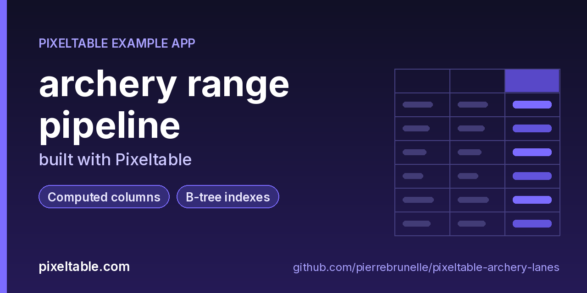

<!-- pixeltable-example-app: 20261014-archery-lanes -->
# archery range pipeline built with Pixeltable



[](https://codespaces.new/pierrebrunelle/pixeltable-archery-lanes?quickstart=1)
[](https://pixeltable.com)
[](https://pypi.org/project/pixeltable/)
[](https://github.com/pixeltable/pixeltable)
[](LICENSE)

Archery Lanes is a scheduled Pixeltable pipeline for a club range. It imports legacy session JSON in watermarked batches, derives calendar fields with pixeltable.functions.date, scores each session with computed columns (then alter_computed_column to the club X-ring bonus formula), and keeps inserts idempotent across ticks. It also verifies boto3 imports as a Pixeltable core dependency. Drive it with `python pipeline.py` — no HTTP router.

[Pixeltable](https://pixeltable.com) is open-source, Python-native **multimodal AI data infrastructure**: tables, incremental computed columns, UDFs, indexes and serving in one library, running locally or on Pixeltable Cloud.

> ⭐ **Like this example?** Star [pixeltable/pixeltable](https://github.com/pixeltable/pixeltable) on GitHub. It helps other developers find it.

## What this example shows

- **Incremental computed columns** powered by plain Python UDFs (`@pxt.udf`)
- **B-tree indexes** declared on the model (`__indexes__`) back the lookup queries
- **Importable UDF module**: UDFs live in `udfs.py`; tables and queries live in `app.py` (Pixeltable resolves UDFs by module path)
- **`pixeltable.toml`** declares a local database and a **Pixeltable Cloud** database, so the same code deploys with `pxt db update`


## What's inside

| File | What it is |
|------|------------|
| `.devcontainer/devcontainer.json` | GitHub Codespaces / Dev Container config: Python 3.12, installs `requirements.txt` |
| `.github/social-preview.png` | Social preview image (1280x640) |
| `CITATION.cff` | Citation metadata (authors, license, release date, keywords) |
| `app.py` | Tables declared as Python classes and `@pxt.query` functions |
| `data/legacy_sessions.json` | Sample data |
| `data/legacy_sessions_batch1.json` | Sample data |
| `data/legacy_sessions_batch2.json` | Sample data |
| `pipeline.py` | Archery Lanes scheduled-pipeline driver (no HTTP service) |
| `pixeltable.toml` | Project config: the local database plus a Pixeltable Cloud database (sizing, deploy excludes) |
| `udfs.py` | Pixeltable UDFs (`@pxt.udf`) in their own importable module, imported by `app.py` |
| `requirements.txt` / `pyproject.toml` | Dependencies (`pixeltable>=0.7.16`) |

**Tables**

| Table | Stored columns | Computed columns |
|-------|---------|------------------|
| `sessions` | `session_code`, `archer`, `lane`, `session_date`, `arrows`, `hits`, `x_rings`, `notes` | `session_id`, `session_year`, `session_month`, `session_day`, `session_weekday`, `session_iso_weekday`, `session_iso`, `next_practice`, `calendar_label`, `band`, `tag`, `boto3_ok` |

## Run in your browser (GitHub Codespaces)

[](https://codespaces.new/pierrebrunelle/pixeltable-archery-lanes?quickstart=1)

1. Click **Open in GitHub Codespaces** above (or [this link](https://codespaces.new/pierrebrunelle/pixeltable-archery-lanes?quickstart=1)). The dev container installs Python 3.12 and `pixeltable>=0.7.16` from `requirements.txt`.
2. In the codespace terminal, create the tables, seed them and run the app:

   ```bash
   pxt schema update app.py archery
   pip install -U 'pixeltable[serve]'
   pxt schema update app.py archery
   python pipeline.py --all-batches
   python pipeline.py   # second tick is a no-op once batches are drained
   ```


## Quickstart

Requires Python 3.11+ and `pixeltable>=0.7.16`.

```bash
git clone https://github.com/pierrebrunelle/pixeltable-archery-lanes.git
cd pixeltable-archery-lanes
python -m venv .venv && source .venv/bin/activate
pip install -r requirements.txt

# Create the tables in a local catalog directory named `archery`
pxt schema update app.py archery

pip install -U 'pixeltable[serve]'
pxt schema update app.py archery
python pipeline.py --all-batches
python pipeline.py   # second tick is a no-op once batches are drained
```

## Deploy to Pixeltable Cloud

The same `app.py` runs on [Pixeltable Cloud](https://pixeltable.com). Sign in (or get a free trial database with `pxt new`), point the second database entry in `pixeltable.toml` at your own database, then deploy:

```bash
pxt login                       # or: export PIXELTABLE_API_KEY=<your-api-key>
# edit pixeltable.toml: name = 'pxt://<your-org>:<your-db>'
pxt db update pxt://<your-org>:<your-db>                 # build the image and upload the project
pxt schema update app.py pxt://<your-org>:<your-db>/archery   # create the tables in the hosted database
```

Keep keys in environment variables or `pxt secret set`, never in code.

## Code walkthrough

**1. Business logic is plain Python, in `udfs.py`.** A `@pxt.udf` function can be used as a column expression. Pixeltable records UDFs by module path (`udfs.score_band`), so they live in their own importable module rather than inline in the app: the daemon, serving workers and Pixeltable Cloud import it again by that path.

```python
# udfs.py
@pxt.udf
def score_band(pct: float) -> str:
    """Map hit percentage into a lane band label."""
    if pct is None:
        return 'unknown'
    p = float(pct)
    if p < 50:
        return 'novice'
    if p < 70:
        return 'developing'
    if p < 85:
        return 'club'
    return 'elite'
```

**2. Tables are Python classes (`app.py`).** Annotated attributes are stored columns; attributes assigned an expression are **computed columns** (`session_id`, `session_year`, `session_month`, `session_day`, `session_weekday`, `session_iso_weekday`, `session_iso`, `next_practice`, `calendar_label`, `band`, `tag`, `boto3_ok`), evaluated incrementally on every insert or update and recomputed when their inputs change. Indexes live next to the columns.

```python
# app.py
class Sessions(TableModel, name='sessions', has_default_idxs=False):
    """One archery-range scoring session migrated from legacy JSON."""

    session_id = pxt.Column(value=pxtf.uuid.uuid7(), primary_key=True)
    session_code: pxt.String
    archer: pxt.String
    lane: pxt.Int
    session_date: pxt.Date
    arrows: pxt.Int
    hits: pxt.Int
    x_rings: pxt.Int
    notes: pxt.String

    # --- fn.date secondary ---
    session_year = pxtd.year(session_date)
    session_month = pxtd.month(session_date)
    session_day = pxtd.day(session_date)
    session_weekday = pxtd.weekday(session_date)  # Mon=0 .. Sun=6
    session_iso_weekday = pxtd.isoweekday(session_date)
    session_iso = pxtd.isoformat(session_date)
    next_practice = pxtd.add_days(session_date, 7)
    calendar_label = pxtd.strftime(session_date, '%a %b %d, %Y')

    # --- scoring (v1: hit%; later altered to include X-ring bonus) ---
    hit_pct = (hits * 100.0) / arrows
    # Club formula (v2): hit% + 2 per X-ring. pipeline.py alters from v1 hit_pct -> this.
    score = (hits * 100.0) / arrows + (x_rings * 2.0)
    band = score_band(hit_pct)
    tag = archer_tag(archer, lane)
    boto3_ok = boto3_core_probe()

    __indexes__ = [
        pxt.BtreeIndex(archer),
        pxt.BtreeIndex(lane),
        pxt.BtreeIndex(session_date),
        pxt.BtreeIndex(band),
        pxt.BtreeIndex(session_code),
    ]
```

**3. Queries are functions (`app.py`).** `@pxt.query` wraps a Pixeltable query so it can be called from Python or exposed as a route:

```python
# app.py
@pxt.query
def by_archer(archer: str):
    """Sessions for one archer, newest first."""
    return (
        Sessions.where(Sessions.archer == archer)
        .select(
            Sessions.session_code,
            Sessions.session_date,
            Sessions.lane,
            Sessions.hit_pct,
            Sessions.score,
            Sessions.band,
            Sessions.calendar_label,
            Sessions.next_practice,
        )
        .order_by(Sessions.session_date, asc=False)
    )
```

## Learn more

- 🌐 Website: https://pixeltable.com
- 📚 Docs: https://docs.pixeltable.com
- 💻 Source: https://github.com/pixeltable/pixeltable (⭐ star it if Pixeltable is useful to you)
- 📦 PyPI: https://pypi.org/project/pixeltable/
- 🧩 More example apps: https://pierrebrunelle.github.io/awesome-pixeltable-apps/

**[More Pixeltable example apps →](https://pierrebrunelle.github.io/awesome-pixeltable-apps/)**

---

<sub>Built as part of a daily series of Pixeltable example apps · Pixeltable 0.7.16 · Python, incremental computed columns · Licensed under Apache-2.0.</sub>
